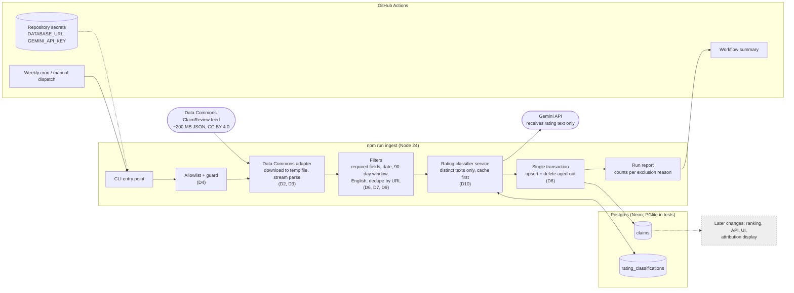
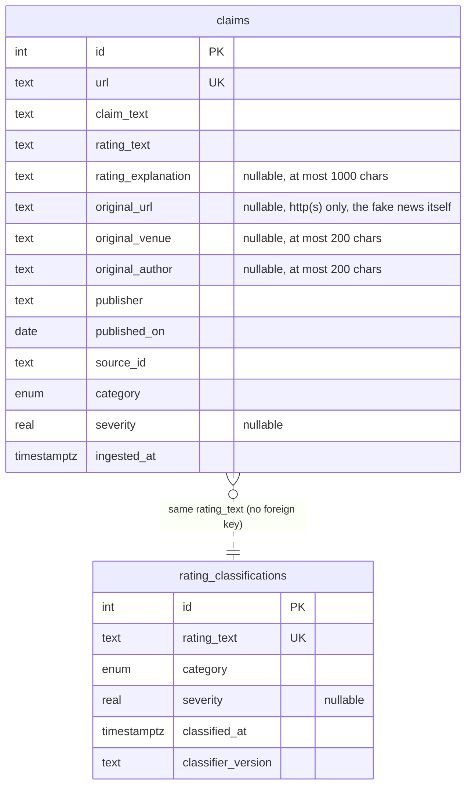

# Architecture

How the application is put together today. This is the living overview: update it when a change alters the structure.
The reasoning behind each choice (the ADRs) is in the design of the change that introduced it,
`openspec/changes/archive/*-ingest-data-commons-feed/design.md`. What the system must do is in `openspec/specs/`.

## What it is

A weekly job turns Google's Data Commons ClaimReview feed (a public fact-check dataset, about 200 MB, CC BY 4.0) into a
small Postgres table of recent English-language fact-checks, each with a category and severity for its rating. A later
web UI will read that table. Only the ingestion exists so far.

## Components

Solid arrows are built; the dashed box is future work.

## One run, step by step

1. **Allowlist check.** Only sources listed in `src/allowlist/allowlist.ts` (access method, license, attribution) can be fetched. An unlisted source is refused before any request.
2. **Download** the full snapshot to a temp file (honest user-agent, redirects refused, truncated or non-JSON content fails the run).
3. **Stream-parse** the file into neutral `RawReview` values (including the optional rating explanation and claim origin), so memory stays flat.
4. **Filter**, counting every exclusion under one reason: required fields, valid date, not in the future, inside the 90-day window, English claim text. The optional fields are not filters: the explanation, venue and author are capped, the original URL is kept only if it is an http(s) URL, all are carried on the record, and a missing one excludes nothing.
5. **Dedupe** by URL (the last review in the snapshot wins).
6. **Classify** each distinct rating text: cache first (`rating_classifications`), then the Gemini model for unseen texts. Failures become `unclassifiable` for this run and are retried next run.
7. **Store** in one transaction: upsert the records on `url`, delete rows that aged out of the window. Any error rolls everything back.
8. **Report**: counts read, stored, removed and excluded per reason, printed and written to the workflow summary.

## Data model

- `claims.url` is unique and is the upsert key. The surrogate `id` is the primary key, so changing the dedupe rule later only replaces a unique constraint.
- "Negative" (false or misleading) is derived from `category`, not stored.
- Only claim text, rating text, publisher, date, the link back and, when the feed has them, the publisher's rating explanation and the claim's origin (original URL, venue, author name) are stored. There is no column for article text, by design.
- `rating_explanation` is nullable and capped at 1000 characters, cut at a word boundary with an ellipsis. It is per review, so it lives on `claims` and not in the rating cache, and it is never sent to the classifier. Reasoning: ADR E1 in the design of the `store-claim-context` change (`openspec/changes/`, under `archive/` once archived).
- **The original URL is the fake news itself.** The claim-origin columns (`original_url`, `original_venue`, `original_author`, added by the same change) point at the false or misleading content. They are stored, never requested, and any UI that shows them must say so in plain words, never as a source or reference (ADR E7 in that design, and the rule in `CLAUDE.md` and `openspec/config.yaml`). The URL is validated as http(s), stored as given and never requested; the author name may identify a private person (ADR E6).
- `rating_classifications` is a cache keyed by rating text; `classifier_version` marks which model and prompt produced a row.

## Where things live

| Path | What |
| --- | --- |
| `src/allowlist/` | Allowlist config (zod-validated) and the guard that refuses unlisted sources |
| `src/sources/` | Source adapters behind one interface; `data-commons/` downloads and parses the feed |
| `src/pipeline/` | Filters, language detection, exclusion reasons, dedupe and the run (`run.ts`) |
| `src/classification/` | Classifier interface, the Gemini classifier, the cache store, validation |
| `src/db/` | Drizzle schema (`drizzle/` holds the migrations) |
| `src/cli/ingest.ts`, `scripts/ingest.ts` | The `npm run ingest` entry point and the run report |
| `.github/workflows/ingest.yml` | Weekly cron and manual dispatch; secrets `DATABASE_URL` and `GEMINI_API_KEY` |
| `app/` | Next.js skeleton, not built out yet |
| `tests/` | See `tests/test-guide.md` |

## Key decisions

- **Weekly full snapshot, no deltas.** Simple at this size; volume is about 300 English reviews per 90 days. The download is the cost, not the data.
- **A scheduled GitHub Actions job, not a serverless route.** A 200 MB download plus classification can exceed serverless time limits.
- **Source adapters and an allowlist.** The legal rules are enforced by code and tests: stored fields, allowlist, attribution data, no contact with publisher sites. A second source means a new adapter and an allowlist entry.
- **URL as the upsert key.** Known cost: an article that reviews several claims keeps only one. Revisit if that becomes common (watch `duplicate-url` in the run report).
- **Deterministic language detection.** Two offline libraries (`franc-min` or `tinyld`) behind a Latin-letter guard, chosen by a labeled fixture test. No LLM.
- **The LLM sees only rating text.** Never the claim, URL or publisher. Results are cached by exact text and classifier version.
- **Tests run offline.** A fixture trimmed from the real feed, a fake classifier, and PGlite (in-process Postgres) instead of Neon.

## Running and checking

- Run the ingestion and the setup: `docs/ingestion.md`. The classifier's categories and how to change the model: `docs/rating-classification.md`.
- Tests: `tests/test-guide.md`.
- Inspect the database: the `query-database` skill.
