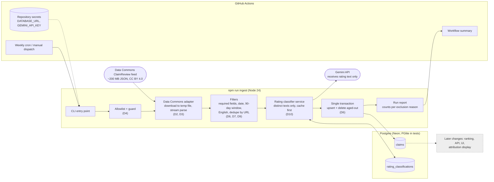
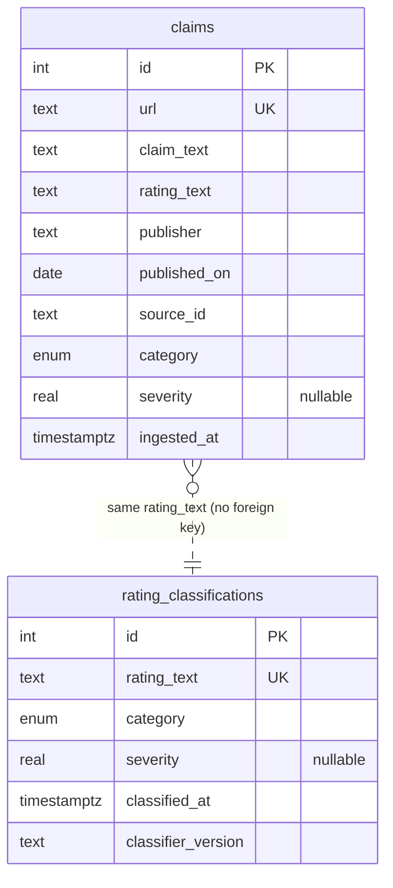
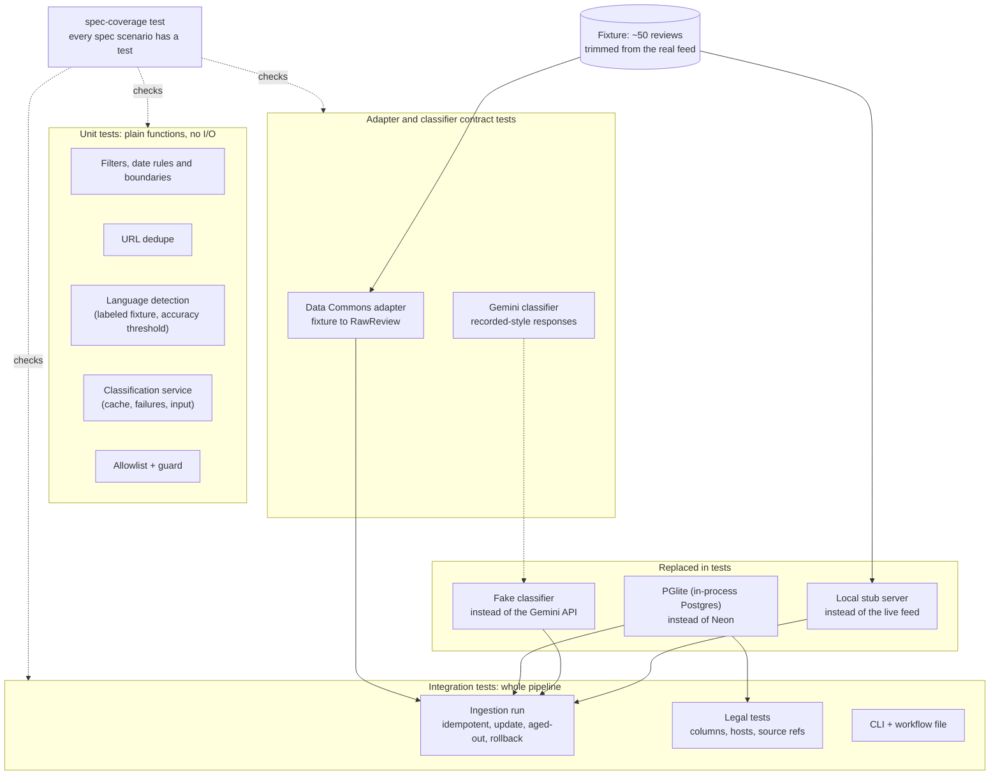

# Design

## Context

Greenfield project: no code exists yet. See `proposal.md` for motivation and scope, and the three specs (`source-allowlist`, `claim-ingestion`, `rating-classification`) for required behavior.

Facts about the feed that shape the design (checked 2026-10-31 against the real file):
- One JSON document of about 200 MB: `DataFeed` with `dataFeedElement[]`, each element holding `item[]` of `ClaimReview` objects. About 94,000 elements and 100,000 reviews.
- Useful fields per review: `author.name` (publisher), `claimReviewed`, `datePublished`, `reviewRating.alternateName` (rating text), `url`. Everything else is ignored and never stored.
- No language field and no `sdLicense`. About 10% of reviews have no `datePublished`, and a few are dated in the future.
- About 300 English reviews fall in any 90-day window, so the data set is small. Volume is not a design constraint; the size of the download is.

## Goals / Non-Goals

**Goals:**
- A weekly script that turns the feed into a small, clean table of records the later ranking and UI changes can read.
- Every legal rule in the specs enforced by code and covered by tests: stored fields, allowlist, attribution data.
- Adapters behind one interface so a second source can be added later without touching the pipeline.
- All automated tests run offline against a recorded fixture and a fake classifier.

**Non-Goals:**
- Ranking, an API, the UI and the attribution display. This change only stores what they need.
- Incremental or delta fetching. A weekly full snapshot is simple enough at this size.
- Publisher canonicalization, multi-claim articles, non-English claims.

## Components

How the pieces fit together. Solid arrows are built in this change; the dashed box is out of scope (see Non-Goals). The decisions below explain each piece.



## Decisions

### D1. Pipeline shape

```
 allowlist --> adapter.fetch() --> temp file --> adapter.parse() (stream)
                                                      |
                                       NormalizedRecord (raw, unfiltered)
                                                      v
                          filters: required fields -> date -> window -> language
                                                      v
                              dedupe by URL (last one in the run wins)
                                                      v
                         classify distinct rating texts (cache first, then LLM)
                                                      v
                      one DB transaction: upsert records, delete aged-out, commit
                                                      v
                                          run report (counts per reason)
```

Each stage is a plain function over typed values, so each can be unit-tested without the network or the database.

Every review that is not stored is counted under exactly one exclusion reason, so the run report adds up (`read = stored + all excluded`):

| Reason | Stage | Meaning |
| --- | --- | --- |
| `malformed` | adapter | the feed entry could not be read |
| `missing-claim-text` | required fields | no claim text |
| `missing-url` | required fields | no URL |
| `missing-publisher` | required fields | no publisher name |
| `missing-rating-text` | required fields | no rating text (every stored record has one, and the classifier needs it) |
| `invalid-date` | date | date missing, unparseable or not a real calendar date |
| `future-date` | date | later than the run date |
| `outside-window` | window | older than 90 days |
| `non-english` | language | claim not detected as English, or undetermined |
| `duplicate-url` | dedupe | superseded by a later review with the same URL in the same run |

### D2. Source adapter interface

An adapter is `{ sourceId, fetchSnapshot(): Promise<localFilePath>, parse(path): AsyncIterable<RawReview> }`. The pipeline owns filtering, dedupe, classification and storage; the adapter owns only download and mapping to the neutral `RawReview` shape (claim text, rating text, publisher, published-date string, URL). Filters therefore never see feed-specific structure. A second source would implement the same interface and add an allowlist entry.

*Alternative considered:* one function that reads the feed directly. Rejected because the project is explicitly about a multi-source architecture, and the interface costs very little.

### D3. Download to a temp file, parse as a stream

The snapshot is downloaded to a temporary file, then parsed with a streaming JSON parser (stream through `dataFeedElement`), and the file is deleted at the end of the run. A failed or truncated download therefore fails before any record is processed, and memory stays flat instead of holding a 200 MB string plus its parsed object tree.

The download step also refuses an HTTP error status, an empty body, a body that does not start like a JSON object, a body shorter than the announced `content-length`, and any redirect (`redirect: "error"`, so the request can never leave the allowlisted host). These checks are implementation detail under the spec's "download fails or the content is not a valid feed" scenario, not separate requirements; each is covered by `tests/data-commons-fetch.test.ts`.

*Alternative considered:* `JSON.parse` of the whole body. Works at this size on a CI runner but costs gigabytes of heap and breaks if the file grows.

### D4. Allowlist as validated config, not a database table

The allowlist is a typed config file validated with zod when loaded (fields in the `source-allowlist` spec). It lives in the repository, so changing it is a reviewed code change, and the archive step in the project config can check it. Stored records keep only a `source_id` that refers to it.

Proposed attribution text (Data Commons does not prescribe wording, so this is our best-effort reading of CC BY): "Fact-check data from Google Data Commons (datacommons.org/factcheck), licensed CC BY 4.0. Each item links to the original fact-check by its publisher."

*Alternative considered:* a `sources` table. Rejected: nothing needs to change it at runtime, and a table would hide legal changes from code review.

### D5. Data model (Drizzle, Postgres)



- `claims`: `id` (surrogate primary key), `url` (unique), `claim_text`, `rating_text`, `publisher`, `published_on` (date), `source_id`, `category`, `severity` (nullable real), `ingested_at`.
- `rating_classifications`: `id` (surrogate primary key), `rating_text` (unique), `category`, `severity` (nullable), `classified_at`, `classifier_version`.

The `id` columns are technical row identifiers and hold no feed data, so they do not conflict with the stored-fields rule. They keep row identity separate from the dedupe rule, which can then change by replacing a unique constraint.

"Negative" is derived from `category` (false or misleading), not stored, so there is a single source of truth. There is no column for article body or any other feed field, which makes the stored-fields rule structural rather than a convention.

### D6. Upsert, window and atomicity

A run computes everything in memory first, then in one transaction runs `INSERT ... ON CONFLICT (url) DO UPDATE` (targeting the unique constraint on `url`) for the qualifying records and `DELETE` for rows whose `published_on` is older than the window. Any error rolls back, so the table is either the previous state or the new one. Classification (the slow, external part) is finished before the transaction opens, and writes to `rating_classifications` happen outside it because they are idempotent and independent of the claims table.

The run date is the UTC date at the start of the run. A review is inside the window when `published_on >= run_date - 90 days`, and in the future when `published_on > run_date`. Boundary days are covered by tests.

### D7. Date parsing

`datePublished` is parsed strictly as an ISO date (the leading `YYYY-MM-DD`, optionally followed by a time). Anything that does not match, or is not a real calendar date, is excluded as invalid. There is no fallback to the feed element's `dateCreated`, per the decision made during exploration.

### D8. ADR: article URL as the upsert key

**Decision:** the original fact-check URL identifies a record.
**Rationale:** simplest key that every review has, stable across runs, and it makes re-running a snapshot idempotent. The URL is a unique constraint, not the primary key: the surrogate `id` is the primary key, so a future switch to a different dedupe key only replaces one unique constraint and does not touch the primary key or anything that references it.
**Known cost:** the real feed has articles that review several claims under one URL; only one of those claims survives per URL (the last one seen in the snapshot). This is accepted for v1 because the feed is thin and the priority is a working end-to-end loop.
**Revisit when:** multi-claim articles turn out to be common (for example, they account for a visible share of the stored window, or users report missing claims). The likely replacement key is `(url, normalized claim text)`.

### D9. ADR: deterministic language detection

**Decision:** a trigram language-detection library (`franc-min` class) run on `claimReviewed`; keep only English. Texts the library cannot decide on ("undetermined") are excluded, since false negatives are safer than showing foreign-language items in an English feed.
**Rationale:** the user ruled out an LLM here; the library is free, offline, deterministic and testable.
**Outcome of the fixture test (decided during apply):** `franc-min` alone kept 84.8% of the labeled English claims (59% of the short ones) and `tinyld` alone 84.8% (73% of the short ones, but only 86% of the long ones); neither let a non-English claim through. Accepting a claim when either library says English kept 93.9% (86% of short, 100% of long) with no non-English claim kept, and over the real 90-day window it recovers about 14 more English records out of roughly 315. That combination is what is implemented, behind a guard that at least 80% of the claim's letters are Latin, which stops a mostly-Sinhala claim containing an English phrase from passing. Undetermined results are still excluded. The minimum text length stays at `franc-min`'s default of 10 (20 gave the same result, 30 was worse).
**Cost:** short claims are the weak spot for trigram detectors. Mitigation: a labeled fixture of real short claims (English and not) with a threshold test, so the choice of library or minimum length can be changed with evidence.
**Alternative considered:** `tinyld` or a CLD-based library; swap in if the fixture test shows better accuracy.

### D10. ADR: the LLM classifies rating text only

**Decision:** a classifier interface `classify(ratingTexts: string[]) -> {category, severity}[]`, implemented with a Google Gemini model (a small, cheap model is enough, `gemini-3.5-flash-lite`) using structured JSON output validated by zod. Input is the distinct rating text only, truncated to a maximum length, never the claim, URL or publisher.
**Rationale:** it is the one place where language understanding is required (free-form multilingual text, sometimes whole sentences), and caching by exact string keeps calls to the number of distinct texts, not records.
**Provider choice (changed during apply):** the first implementation used an Anthropic model. It was switched to Gemini because a Gemini API key was available and the Anthropic account had no credit. Nothing else changed: the classifier interface, the prompt, the cache and the failure handling are provider-independent, and only `src/classification/gemini.ts` knows the provider. Data sent to the provider is unchanged: the distinct rating text only. Note that Google may use content sent on the free tier of the Gemini API to improve its products; rating texts are short public labels written by fact-checkers, which is acceptable here, but revisit this (paid tier) if anything more sensitive is ever sent.
**Failure mode:** an error or invalid output marks the affected texts unclassifiable for this run and does not cache them, so the next run retries them.
**Tests:** a fake classifier is injected; no test calls a model.

### D11. Scheduling and secrets

A GitHub Actions workflow runs the ingestion script on a weekly cron and on manual dispatch. The database URL and the LLM key are repository secrets, never in code. The script prints the run report and also writes it to the workflow summary. A scheduled workflow is used instead of a serverless route because a 200 MB download plus classification can exceed serverless time limits.

### D12. Test strategy

What each kind of test runs for real and what it replaces. Nothing in the suite touches the live feed, a publisher site or the Gemini API.



- **Fixture:** a small file trimmed from the real feed (about 50 reviews) covering every exclusion reason: missing and invalid dates, a future date, outside-window, non-English, missing fields, duplicate URL, a bilingual rating, and a long sentence rating. It is committed together with a notice that the data comes from Data Commons under CC BY 4.0.
- **Adapter contract test:** the Data Commons adapter maps the fixture to `RawReview` correctly and ignores extra fields.
- **Unit tests:** each filter, the date rules and boundaries, the URL dedupe, and the cache behavior with a fake classifier.
- **Test database:** tests run against PGlite, a real Postgres engine compiled to WASM that runs inside the test process (decided during apply, because no local Postgres or working Docker was available). It needs no server, so tests stay offline and run unchanged in CI. Production uses Neon; the migrations are the same SQL.
- **Ingestion integration test:** the whole pipeline over the fixture against Postgres (PGlite, see above), including idempotent re-runs, rollback on failure and removal of aged-out rows. The download is replaced by a local file server or a stub, never the live URL.
- **Legal tests:** stored columns equal the permitted list; no request goes to a host other than the feed host; an unlisted source is refused.
- **Playwright** is not used in this change; it arrives with the UI change.

## Risks / Trade-offs

- **Feed is thin and skewed** (a handful of publishers, mostly South and Southeast Asia, about 300 English reviews per 90 days) → accepted; the UI change should be honest about coverage. Not solvable within the licensing constraints chosen.
- **Feed format or URL changes** → the zod schema for `RawReview` mapping fails the run loudly instead of storing garbage; the previous data stays untouched because of the atomic run.
- **Language detection errors on short claims** → fixture-based accuracy test (D9); undetermined results are excluded.
- **One claim per URL** → recorded as D8 with a revisit trigger.
- **LLM misclassification or drift** → results are cached with a `classifier_version`, so a changed prompt or model can invalidate old results deliberately; the unclassifiable outcome avoids forced guesses.
- **Rating text sent to an external provider** → only the distinct rating text, never claims or URLs (specified and tested).
- **Residual publisher-terms risk** (Data Commons notes publishers may have their own terms) → minimal stored fields, mandatory link back, no article text, attribution data carried with each record.
- **Attribution wording is our own interpretation** → documented in D4 and easy to change in one place.
- **Download size and time** → one 200 MB download per week is acceptable on a CI runner; the temp file is deleted after the run.
- **Free-tier limits** (Neon storage, GitHub Actions minutes) → the stored data is a few hundred rows, so limits are not a concern for this change.

## Migration Plan

Greenfield, so there is nothing to migrate. Order of rollout: create the database and the secrets, run the schema migration, run the ingestion workflow manually once and check the run report and the table, then enable the weekly schedule. Rollback is disabling the workflow; the table can be emptied and rebuilt from the next snapshot at any time because the feed is the source of truth.

## Open Questions

- ~~Which exact language library and minimum text length to use~~ Settled by the labeled fixture test in D9 (`franc-min` plus `tinyld`, minimum length 10).
- Which Gemini model and prompt wording to use for classification is an implementation detail inside D10; the spec behavior does not depend on it.
