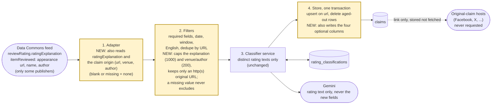

# Design

## Context

The adapter maps each review to a neutral `RawReview` (`src/sources/data-commons/adapter.ts`), the filters keep qualifying ones as `FilteredRecord`s (`src/pipeline/filter-entries.ts`), the run classifies distinct rating texts and upserts on `url` (`src/pipeline/run.ts`). The `claims` table has exactly the permitted columns, and two tests pin that set on purpose (`tests/legal.test.ts`, `tests/schema.test.ts`). The current spec says that explanations and appearance links must not be persisted. See proposal.md for why that changes. The change was built in two steps: the rating explanation first (E1 to E4, implemented, migration `0001` applied), then the claim origin (E5 to E7, added afterwards, migration `0002`).

Feed facts (fixture of 54 reviews, trimmed from the real feed): `reviewRating.ratingExplanation` is present on 14, always for the same publishers; lengths 65 to 570 characters. The feed has no per-record license beyond CC BY 4.0 on the compilation. `itemReviewed` is present on 51 of 54: `appearance[]` on 39 (3 with several entries), `firstAppearance` on 2, `author.name` on 48, `name` on 4. The appearance hosts are mostly Facebook, X and Instagram.

## Goals / Non-Goals

**Goals:**
- Carry an optional, bounded explanation from the feed to the `claims` row, in step with the feed on every run.
- Carry the optional claim origin (URL, venue, author name) the same way, validated so the URL is safe to render as a link.
- Keep the legal limit enforceable by structure and tests, as the stored-fields rule is today.
- Fix, once and project-wide, how the original URL may be shown (E7).

**Non-Goals:**
- Displaying the explanation, or deciding the attribution wording (UI change).
- Any other feed field (images, `reviewBody`, rating scores, the claim's own date, further appearance links).
- Requesting, resolving or archiving the original URL.
- Fixing coverage gaps: a review without an explanation stays without one.

## Ingestion flow, and what changes

The run is the one in `docs/architecture.md`. The highlighted steps are the ones this change touches; the others stay as they are.

What each step does with the explanation, before and after:

| Step | Before | After |
| --- | --- | --- |
| 1. Adapter | Reads claim, rating text, publisher, date and URL; ignores the explanation and `itemReviewed` | Also reads `ratingExplanation` and, from `itemReviewed`, the first-appearance or first listed appearance URL, `name` and `author.name`; a blank or missing value becomes "none" |
| 2. Filters | Exclude on required fields, date, window and language | Same exclusions; none of the new fields is a filter criterion. The explanation is cut to 1000 characters, venue and author to 200, and an original URL that is not absolute http(s) is dropped. The last review for a URL wins, with its values |
| 3. Classifier | Sees distinct rating texts only | Unchanged: still rating texts only, never the new fields |
| 4. Store | Upsert writes the permitted columns | Upsert also writes `rating_explanation`, `original_url`, `original_venue` and `original_author`; a re-run replaces them, and a missing one writes null so a removed value is cleared |
| Run report | Counts read, stored, removed, excluded per reason | Unchanged: a review without the optional fields is not an exclusion |

## Decisions

### E1. ADR: store the rating explanation, capped at 1000 characters

**Decision.** The explanation joins the stored fields as an optional field, cut to at most 1000 characters.

**Why.** It is the only "why" the source offers, and the UI would otherwise have nothing between the rating badge and the link out. It is a short rationale written by the publisher for this one review, not the article.

**Legal reasoning.** It is still the publisher's own prose, and the feed carries no per-record license, so unbounded copies are the wrong default. At 1000 characters every explanation in the fixture (the longest is 570) is stored whole, so the cap is a backstop against outliers and not an excerpt rule: it does not by itself reduce what we copy from the publishers we have seen. The mitigation is therefore mostly structural: the record always keeps the publisher and the URL so the UI can attribute and link back, and the explanation is the publisher's rationale for one review, not the article. The cap is a number in one place, so it can be tightened without a schema change.

**Alternatives.**
- Do not store it: safest, but leaves the UI with no explanation for the 64% of rows whose publishers provide one.
- Store it with no cap: simplest, but an unusually long explanation would be copied whole, with no license beyond the compilation's. Rejected in favor of a high cap.
- Cap at 300 characters (the size of the rating-text cache): a real excerpt, but it cuts 5 of the 14 fixture explanations mid-thought. Considered first and replaced by 1000 on the owner's call.
- Store only a boolean "has explanation" and link out: too little to be useful.

**Revisit trigger.** A publisher objects, or a per-record license appears in the feed (then the cap and the stored-fields rule can follow it).

### E2. Column on `claims`, not on the classification cache

The explanation is per review, so it lives on `claims`: `rating_explanation text`, nullable. `rating_classifications` is keyed by rating text and shared by many claims, so an explanation there would be wrong for all but one of them. No default and no backfill value: null means the feed gave none.

### E3. Where each step happens

- **Adapter:** maps `reviewRating.ratingExplanation` to an optional `ratingExplanation` on `RawReview` using the same non-blank helper as the other fields. It does not judge or cut it, in line with D2 (judging parts is the pipeline's job).
- **Filters:** `filterEntries` copies the explanation onto the `FilteredRecord` after applying the cap through one small pure function. A missing explanation never excludes a review, so no exclusion reason and no change to the run report's counts.
- **Cap function:** if the text has 1000 characters or fewer it is unchanged; otherwise it takes the first 999 characters, cuts back to the last whitespace when there is one (a single long word is cut hard at 999), trims trailing whitespace, and appends "…" (so the total never exceeds 1000). A text of 1000 characters or fewer is stored exactly as the feed wrote it, with no trimming.
- **Duplicate URL:** the last review wins, including its explanation, or its lack of one. This follows from D8 and needs no special case.
- **Classifier:** `classifyRecords` already sends distinct rating texts only. The explanation travels on the record but is never passed to the classifier; a test pins this.
- **Store:** the insert includes the explanation, and the upsert's `set` includes it as `excluded.rating_explanation`, so a changed explanation replaces the old one and an absent one writes null.

### E4. Migration and backfill

Two generated migrations, each adding nullable columns (`0001`: the explanation, applied; `0002`: the three origin columns); existing rows get null. The next `npm run ingest` (idempotent, classification cache avoids repeat Gemini calls) fills in the explanations of the stored claims. Running it touches Neon and Gemini, so it happens on request and is not part of the tasks.

### E5. ADR: store the claim origin (URL, venue, author name)

**Decision.** Three optional fields from `itemReviewed` join the stored fields: `original_url`, `original_venue` and `original_author`, as nullable text columns on `claims` (the origin is per review, so the same reasoning as E2 applies).

**The URL.** It is `firstAppearance.url` when present, otherwise the first listed `appearance[].url`; anything that is not an absolute http(s) URL counts as missing (the same test as the fact-check URL, so it is always safe to render as a link, and `javascript:` or relative links never get in). `appearance` can be a list or, in other feeds, a single object; the adapter accepts both. One value, not a list: 3 of 54 fixture reviews have several, and the first is the one the publisher lists first. It is stored exactly as given, with no cap, no tracking-parameter stripping and no resolving, and it is never requested, so the "only the feed host is contacted" rule still holds.

**Venue and author.** Short labels, capped at 200 characters each by the same cut function as the explanation, parameterized by its limit. Venue is rare (4 of 54) but nearly free.

**Why.** The URL is the only way for a reader to see the claim as it circulated; it also covers the largest publisher, which provides no explanation (20 of 23 in the fixture). Author and venue say who made the claim and where.

**Alternatives.**
- Store a list of appearance URLs: more complete, but a second table or an array column for 6% of reviews. Revisit if several-appearance claims turn out to be common.
- Fetch the post to show a preview or archive it: contacts third-party hosts and stores their content. Rejected.
- Store only the host name ("facebook.com"): safer, but loses the link, which is the point.

**Revisit trigger.** Several-appearance claims are common, links rot enough to matter, or a host or poster objects.

### E6. ADR: the author name may identify a private person

**Decision.** `original_author` is stored as the feed gives it, capped at 200 characters, and is never sent to the classifier.

**Why this needs an ADR.** The value is "Social media users" or an organization most of the time, but it can be a person's name or a handle, often a private individual who posted something false. Storing it is a personal-data decision, not just a field.

**Mitigations.** It is already public in the fact-check, we store nothing beyond that string, and it is shown only as "who made the claim", next to the rating and the label from E7, never as a source or a reference.

**Alternatives.** Do not store it (the earlier recommendation, which the owner overrode to have the data available); store only values that look like organizations or generic labels (fragile and guessy); anonymize handles (changes data the feed gave).

**Revisit trigger.** A removal request, a decision to anonymize private individuals, or a legal review of the project.

### E7. ADR: the original URL is fake news, and the UI must say so

**Decision.** Any interface that shows `original_url`, `original_venue` or `original_author` must present them as the false or misleading content itself, in plain words next to the rating, and never as a source, citation or "read more". The link must not look like an ordinary link, must carry `rel="noopener noreferrer nofollow"`, and must not be shown without the rating.

**Why.** The page behind `original_url` is, by construction, the misinformation. A reader who sees a normal-looking link next to a claim can take it for evidence and visit it, give it traffic and trust it. A fact-checking product that does that defeats its own purpose.

**Where it is enforced.** This change only stores data, so the rule is written where every later change will meet it: `openspec/config.yaml` (the `specs`, `design` and `tasks` rules, so a future UI proposal, spec and task list cannot be written without it, and the UI tests assert the label), `CLAUDE.md` (for work outside the OpenSpec flow), and `docs/architecture.md` (for readers). This design records the reasoning.

**Alternatives.** A plain link with a caption (too easy to miss); do not show the URL at all and keep it only as data (loses the value, but remains an option for the UI change); show only the host (a compromise the UI change may pick, still labeled).

**Revisit trigger.** The UI change decides how prominent the label is; the rule itself ("labeled as the fake news, never as a source") is not up for revision without the owner.

## Risks / Trade-offs

- [Publisher prose is stored, with no per-record license] → cap, attribution through publisher and URL on every record, ADR E1 with a revisit trigger.
- [Coverage is uneven: about 64% of stored claims, and none for the largest publisher, are estimated from the fixture] → the field is optional and the UI falls back to the link; the real coverage is measurable after the first run with the column.
- [The original URL leads to misinformation, and to a private person's post that may be deleted] → E7 (label, rel attributes, rating alongside), http(s)-only validation, never requested; dead links are accepted and the fact-check link remains.
- [The author name can identify a private individual] → E6: capped, stored as given, never a source, revisit triggers.
- [Origin coverage is uneven: the URL on about 76% and venue on about 7% of the fixture] → all optional; the UI falls back to the fact-check link.
- [A cut at 1000 characters can end a sentence mid-thought] → the ellipsis marks it, and the full text is one click away at the publisher.
- [Length counts JavaScript string units, so a cut could split an emoji or other astral character] → cut back one unit if the last kept unit is a high surrogate.
- [The pinned-column tests must change on purpose] → expected: the tests are the guard working, and each is updated in the same task group as the schema.

## Migration Plan

1. Land the change (migrations, code, tests, docs, rules). `npm run db:migrate` applies the columns to Neon on request: `0001` (explanation) is already applied, `0002` (origin) is new. Never edit `0001`.
2. Run `npm run ingest` on request to fill the values. The same run fills origin and explanation for every claim in the snapshot.
3. Rollback: drop the columns in a new migration; nothing else reads them yet.
