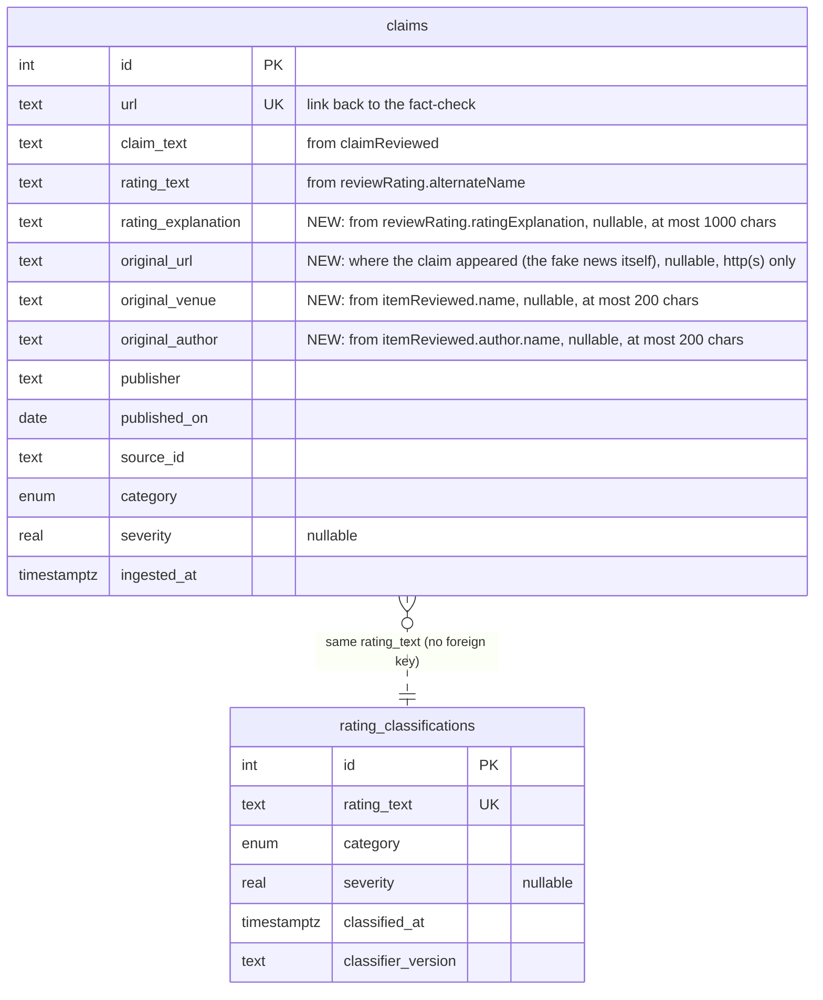

# Proposal

## Why

A web UI listing claims needs more than a claim and a one-word rating. Readers need to know why the claim got its rating, and where the claim came from. The Data Commons ClaimReview feed carries both, and the ingestion discards them today:

- `reviewRating.ratingExplanation`: publisher-written text about one specific review ("None of the videos show Cyclone Arnab ..."). The "Stored fields are limited" requirement even names explanations as a field that must not be persisted.
- `itemReviewed`: where the claim appeared (`firstAppearance.url`, `appearance[].url`), a venue label (`name`, "In a Facebook post") and who made it (`author.name`).

A look at the fixture (trimmed from the real feed, 54 reviews) shows both are optional and publisher-dependent:

| Field | Present in the fixture | Notes |
| --- | --- | --- |
| rating explanation | 14 of 54 (26%) | FACTLY, VERA Files, FactCheck.org, FactRakers and Policy Wire always have it; Fact Crescendo Sri Lanka (the largest publisher, 108 of 305 stored claims) and Deutsche Welle never do. 65 to 570 characters. |
| original-claim URL | 41 of 54 (76%) | `firstAppearance` on 2, `appearance[]` on 39 (3 have several). Mostly Facebook, X and Instagram, a few news sites and one screenshot host. Fact Crescendo Sri Lanka has it on 20 of 23, so the two fields together cover almost every claim. |
| original author name | 48 of 54 | "Social media users", an organization, a person or a handle. |
| original venue name | 4 of 54 | Rare ("In a Facebook post"). |

The UI will fall back to the link to the original fact-check when an optional field is missing.

**The original URL points at the fake news itself.** It is not a source for the claim. The design records a project-wide rule that any UI showing it must say so plainly (design E7).

## What Changes

Rating explanation (implemented first):
- Read `reviewRating.ratingExplanation` and store it as an optional field: absent or blank means none. Store at most the first 1000 characters (cut at a word boundary, marked as cut). Every fixture explanation fits whole; the cap is a backstop against outliers, not an excerpt rule.

Claim origin (added to this change afterwards):
- Store the original-claim URL as an optional field: `itemReviewed.firstAppearance.url` when present, otherwise the first usable `itemReviewed.appearance[].url`. Only an absolute http(s) URL is kept; anything else counts as missing.
- Store the original claim's venue (`itemReviewed.name`) and author name (`itemReviewed.author.name`) as optional fields, each capped at 200 characters.

Both parts:
- A missing optional field never excludes a review. A re-run updates every one of them, and clears it when the feed no longer has it.
- Amend the "Stored fields are limited" requirement: the optional fields join the permitted ones, and the old exclusion of explanations is replaced by this bounded permission. Images, further appearance links, `reviewBody` and article bodies stay excluded.
- The original URL is stored, never requested.
- Record the legal reasoning, the privacy reasoning for the author name and the UI rule as ADRs in the design, and put the UI rule in the project-wide rules (`openspec/config.yaml`, `CLAUDE.md`) so every later UI change carries it.

Out of scope:
- The web UI, ranking, and any display of these fields or their attribution (a later change; this one only provides the data, and fixes the rule for how the original URL may be shown)
- Images of any kind, rating scores (`ratingValue`), claim dates, `reviewBody`, and `claimReviewed` quality (corrections written as claims)
- Filling in missing values by any means (LLM, template, another source), and fetching anything from the original URL
- Sending any of these fields to the classifier: the LLM still sees only rating text

### The new fields in the data model

`claims` gains four nullable columns. They sit on `claims`, not on `rating_classifications`, because each is written for one review, while the classification cache is keyed by rating text and shared by many claims. The cache table does not change.

What a row looks like (values from the fixture, shortened):

| Field | A FactRakers review | A Fact Crescendo Sri Lanka review |
| --- | --- | --- |
| `claim_text` | PH the most corrupt country in Asia | a claim sentence |
| `rating_text` | FALSE | False |
| `rating_explanation` | Global corruption indices show many Asian countries worse than PH | `null` |
| `original_url` | a link to the post | a link to a Facebook post |
| `original_venue` | In a Facebook post | `null` |
| `original_author` | Social media posts | Social media users |

## Sources and legal impact

- **Source touched:** the Data Commons ClaimReview feed only, bulk download, no new request and no call to publisher sites. No allowlist change.
- **Explanation:** publisher-written prose, closer to the publisher's own expression than the fields stored so far, although it is not an article body. The feed has no per-record `sdLicense`; the only license on record is CC BY 4.0 on the compilation. Mitigations: the 1000-character cap (a backstop, not an excerpt rule), the publisher and fact-check URL kept on every record, and display with attribution (a UI rule).
- **Original URL:** a link to third-party content, mostly social media posts. It is stored as given and never requested, so no host other than the feed is contacted. Risks: it sends readers to misinformation, the posts are often a private person's, and posts get deleted. Mitigations: the UI rule that labels it as the fake news itself, http(s)-only validation so it is safe to render as a link, and no fetching.
- **Author name:** may identify a private individual (a name or a handle). Capped at 200 characters and stored as the feed gives it. It is displayed only as "who made the claim", never as a source. The design records the revisit triggers.
- **Caching and storage:** four nullable text columns on `claims`. They are removed with the claim when it ages out of the 90-day window.
- **LLM data flow:** unchanged. None of these fields is ever sent to the classifier.

## Capabilities

### New Capabilities

None.

### Modified Capabilities
- `claim-ingestion`: the stored-field limits now include the optional rating explanation and claim origin (original URL, venue, author name), and new requirements cover how each is read, validated, capped, stored and kept in step on re-runs.

## Impact

- **Code:** the Data Commons adapter's mapping, the neutral review type, the filter output type and a shared cap function, the upsert in the run, the `claims` Drizzle schema, and two migrations: `0001` (the explanation, already applied) and a new `0002` (the three origin columns).
- **Existing data:** stored claims have no origin values until the next `npm run db:migrate` and `npm run ingest` (idempotent; the classification cache avoids repeat Gemini calls). Those touch Neon and Gemini and are done on request, not as part of this change.
- **Tests:** the legal and schema tests that pin the exact column set change on purpose; new tests cover presence, absence, validation, the caps and clearing on re-run, using the existing fixture, which has reviews with and without each field.
- **Docs and rules:** `docs/architecture.md` (data model and the UI rule), the stored-fields and UI rules in `CLAUDE.md`, and the artifact rules in `openspec/config.yaml`.
