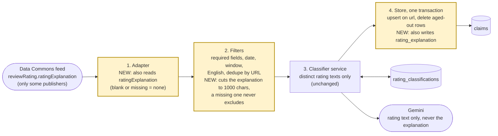

# Design

## Context

The adapter maps each review to a neutral `RawReview` (`src/sources/data-commons/adapter.ts`), the filters keep qualifying ones as `FilteredRecord`s (`src/pipeline/filter-entries.ts`), the run classifies distinct rating texts and upserts on `url` (`src/pipeline/run.ts`). The `claims` table has exactly the permitted columns, and two tests pin that set on purpose (`tests/legal.test.ts`, `tests/schema.test.ts`). The current spec says that explanations must not be persisted. See proposal.md for why that changes.

Feed facts (fixture of 54 reviews, trimmed from the real feed): `reviewRating.ratingExplanation` is present on 14, always for the same publishers; lengths 65 to 570 characters. The feed has no per-record license beyond CC BY 4.0 on the compilation.

## Goals / Non-Goals

**Goals:**
- Carry an optional, bounded explanation from the feed to the `claims` row, in step with the feed on every run.
- Keep the legal limit enforceable by structure and tests, as the stored-fields rule is today.

**Non-Goals:**
- Displaying the explanation, or deciding the attribution wording (UI change).
- Any other feed field (images, `itemReviewed`, appearance links).
- Fixing coverage gaps: a review without an explanation stays without one.

## Ingestion flow, and what changes

The run is the one in `docs/architecture.md`. The highlighted steps are the ones this change touches; the others stay as they are.

What each step does with the explanation, before and after:

| Step | Before | After |
| --- | --- | --- |
| 1. Adapter | Reads claim, rating text, publisher, date and URL; ignores the explanation | Also reads `ratingExplanation`; a blank or missing one becomes "none" |
| 2. Filters | Exclude on required fields, date, window and language | Same exclusions; the explanation is not a filter criterion. It is cut to 1000 characters and carried on the record. The last review for a URL wins, with its explanation |
| 3. Classifier | Sees distinct rating texts only | Unchanged: still rating texts only, never the explanation |
| 4. Store | Upsert writes the permitted columns | Upsert also writes `rating_explanation`; a re-run replaces it, and a missing one writes null so a removed explanation is cleared |
| Run report | Counts read, stored, removed, excluded per reason | Unchanged: a review with no explanation is not an exclusion |

## Decisions

### E1. ADR: store the rating explanation, capped at 1000 characters

**Decision.** The explanation joins the stored fields as an optional field, cut to at most 1000 characters.

**Why.** It is the only "why" the source offers, and the UI would otherwise have nothing between the rating badge and the link out. It is a short rationale written by the publisher for this one review, not the article.

**Legal reasoning.** It is still the publisher's own prose, and the feed carries no per-record license, so unbounded copies are the wrong default. At 1000 characters every explanation in the fixture (the longest is 570) is stored whole, so the cap is a backstop against outliers and not an excerpt rule: it does not by itself reduce what we copy from the publishers we have seen. The mitigation is therefore mostly structural: the record always keeps the publisher and the URL so the UI can attribute and link back, and the explanation is the publisher's rationale for one review, not the article. The cap is a number in one place, so it can be tightened without a schema change.

**Alternatives.**
- Do not store it: safest, but leaves the UI with no explanation for the 64% of rows whose publishers provide one.
- Store it with no cap: simplest, but an unusually long explanation would be copied whole, with no license beyond the compilation's. Rejected in favor of a high cap.
- Cap at 300 characters (the size of the rating-text cache): a real excerpt, but it cuts 5 of the 14 fixture explanations mid-thought. Considered first and replaced by 1000 on the owner's call.
- Store only a boolean "has explanation" and link out: too little to be useful.

**Revisit trigger.** A publisher objects, or a per-record license appears in the feed (then the cap and the stored-fields rule can follow it).

### E2. Column on `claims`, not on the classification cache

The explanation is per review, so it lives on `claims`: `rating_explanation text`, nullable. `rating_classifications` is keyed by rating text and shared by many claims, so an explanation there would be wrong for all but one of them. No default and no backfill value: null means the feed gave none.

### E3. Where each step happens

- **Adapter:** maps `reviewRating.ratingExplanation` to an optional `ratingExplanation` on `RawReview` using the same non-blank helper as the other fields. It does not judge or cut it, in line with D2 (judging parts is the pipeline's job).
- **Filters:** `filterEntries` copies the explanation onto the `FilteredRecord` after applying the cap through one small pure function. A missing explanation never excludes a review, so no exclusion reason and no change to the run report's counts.
- **Cap function:** if the text has 1000 characters or fewer it is unchanged; otherwise it takes the first 999 characters, cuts back to the last whitespace when there is one (a single long word is cut hard at 999), trims trailing whitespace, and appends "…" (so the total never exceeds 1000). A text of 1000 characters or fewer is stored exactly as the feed wrote it, with no trimming.
- **Duplicate URL:** the last review wins, including its explanation, or its lack of one. This follows from D8 and needs no special case.
- **Classifier:** `classifyRecords` already sends distinct rating texts only. The explanation travels on the record but is never passed to the classifier; a test pins this.
- **Store:** the insert includes the explanation, and the upsert's `set` includes it as `excluded.rating_explanation`, so a changed explanation replaces the old one and an absent one writes null.

### E4. Migration and backfill

One generated migration adds the nullable column; existing rows get null. The next `npm run ingest` (idempotent, classification cache avoids repeat Gemini calls) fills in the explanations of the stored claims. Running it touches Neon and Gemini, so it happens on request and is not part of the tasks.

## Risks / Trade-offs

- [Publisher prose is stored, with no per-record license] → cap, attribution through publisher and URL on every record, ADR E1 with a revisit trigger.
- [Coverage is uneven: about 64% of stored claims, and none for the largest publisher, are estimated from the fixture] → the field is optional and the UI falls back to the link; the real coverage is measurable after the first run with the column.
- [A cut at 1000 characters can end a sentence mid-thought] → the ellipsis marks it, and the full text is one click away at the publisher.
- [Length counts JavaScript string units, so a cut could split an emoji or other astral character] → cut back one unit if the last kept unit is a high surrogate.
- [The pinned-column tests must change on purpose] → expected: the tests are the guard working, and each is updated in the same task group as the schema.

## Migration Plan

1. Land the change (migration, code, tests, docs). `npm run db:migrate` applies the column to Neon on request.
2. Run `npm run ingest` on request to fill the explanations.
3. Rollback: drop the column in a new migration; nothing else reads it yet.
