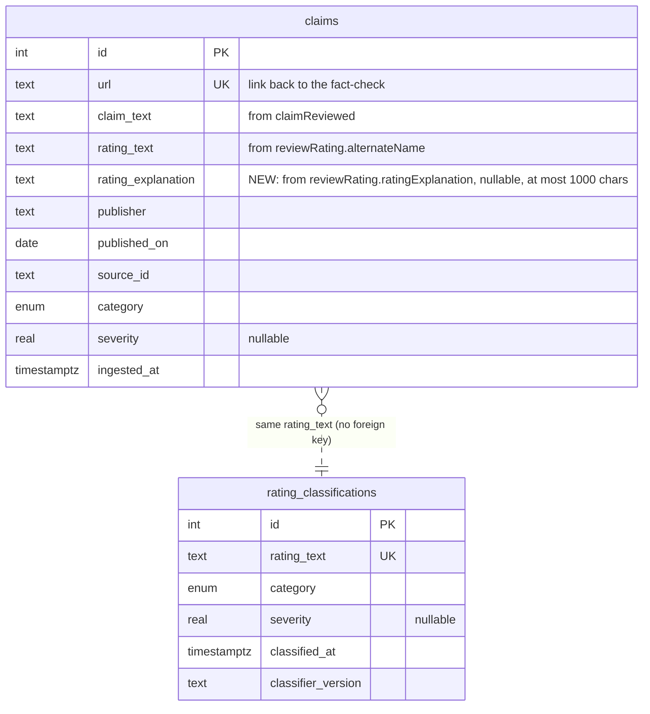

# Proposal

## Why

A web UI listing claims needs to tell readers why a claim got its rating, not only that it got one. The Data Commons ClaimReview feed carries that in `reviewRating.ratingExplanation`: publisher-written text about one specific review ("None of the videos show Cyclone Arnab ..."). The ingestion discards it today, and the "Stored fields are limited" requirement even names explanations as a field that must not be persisted.

A look at the fixture (trimmed from the real feed, 54 reviews) shows the field is present on 14 of them (about 26%) and only for some publishers: FACTLY, VERA Files, FactCheck.org, FactRakers and Policy Wire always have it, while Fact Crescendo Sri Lanka (the largest publisher in the database, 108 of 305 claims) and Deutsche Welle never do. The explanations run from about 65 to 570 characters. The field is optional by nature, so the UI will fall back to the link to the original fact-check when it is missing.

## What Changes

- Read `reviewRating.ratingExplanation` from each review and store it as an optional field of the claim record: absent or blank means no explanation.
- Store at most the first 1000 characters (cut at a word boundary, marked as cut). Every explanation in the fixture (65 to 570 characters) fits whole; the cap is a backstop against unusually long ones, not an excerpt rule.
- Keep the explanation in step with the feed: a re-run updates it, and clears it when the publisher removes it.
- Amend the "Stored fields are limited" requirement: the explanation joins the permitted fields, and the old exclusion of explanations is replaced by a bounded permission. Images, appearance links and article bodies stay excluded.
- Record the legal reasoning as an ADR in the design.

Out of scope:
- The web UI, ranking, and any display of the explanation or its attribution (a later change; this one only provides the data)
- Images of any kind, `itemReviewed` provenance, and `claimReviewed` quality (corrections written as claims)
- Filling in missing explanations by any means (LLM, template, another source)
- Sending the explanation to the classifier: the LLM still sees only rating text

### The new field in the data model

`claims` gains one nullable column. It sits on `claims`, not on `rating_classifications`, because the explanation is written for one review, while the classification cache is keyed by rating text and shared by many claims. The cache table does not change.

What a row looks like once the explanation is stored (the values are from the fixture):

| Field | Publisher with an explanation (FactRakers) | Publisher without one (Fact Crescendo Sri Lanka) |
| --- | --- | --- |
| `claim_text` | PH the most corrupt country in Asia | a claim sentence |
| `rating_text` | FALSE | False |
| `rating_explanation` | Global corruption indices show many Asian countries worse than PH | `null` |

## Sources and legal impact

- **Source touched:** the Data Commons ClaimReview feed only, bulk download, no new request and no call to publisher sites. No allowlist change.
- **New legal impact:** the explanation is publisher-written prose, so it is closer to the publisher's own expression than the fields stored so far, although it is not an article body. The feed has no per-record `sdLicense`; the only license on record is CC BY 4.0 on the compilation. Mitigations: the 1000-character cap (a backstop: it limits outliers but does not turn the field into an excerpt), storing it only with the link back, and displaying it with attribution (the display rule belongs to the UI change, but this change keeps the url and publisher on every record). The design records the decision and its revisit trigger.
- **Caching and storage:** a nullable text column on `claims`, at most 1000 characters. The explanation is removed with its claim when the claim ages out of the 90-day window.
- **LLM data flow:** unchanged. Explanations are never sent to the classifier.

## Capabilities

### New Capabilities

None.

### Modified Capabilities
- `claim-ingestion`: the stored-field limits now include the optional rating explanation (capped), and a new requirement covers how the explanation is read, capped, stored and kept in step on re-runs.

## Impact

- **Code:** the Data Commons adapter's mapping, the neutral review type, the filter output type, the upsert in the run, the `claims` Drizzle schema, and one new migration (`rating_explanation`, nullable).
- **Existing data:** the 305 stored claims have no explanation until the next `npm run ingest` (idempotent; the classification cache avoids repeat Gemini calls). That run touches Neon and Gemini and is done on request, not as part of this change.
- **Tests:** the legal and schema tests that pin the exact column set change on purpose; new tests cover presence, absence, the cap, and clearing on re-run, using the existing fixture, which already has reviews with and without explanations.
- **Docs:** `docs/architecture.md` (data model) and the stored-fields rule in `CLAUDE.md`.
